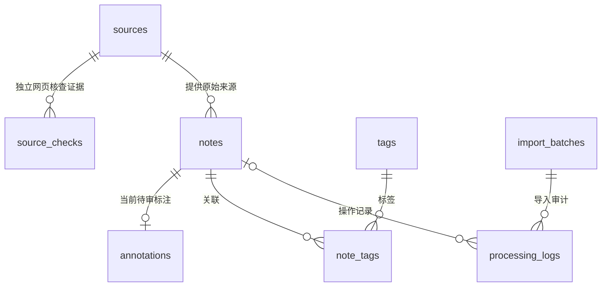

# 数据库设计与接口边界

## 为什么先建样本库

图片要求先搜集别人的笔记、想法并建库。本周工作集中在数据和来源；使用 SQLite 让三位组员无需安装服务就能检查。它和手机端未来使用的 SQLite 属于同一种数据库技术，但这个文件是**公开研究样本库**，不是已完成的 App 离线同步实现。

MySQL 8 仍是最新版需求中的服务端基线。`schema/mysql.sql` 和生成的种子 SQL 要求 MySQL 8.0.29+，可供后端试导入独立的空开发库，不能直接覆盖已有生产表；目前没有 MySQL 运行验证。

## 实体分工

- `sources`：来源 URL、外部作者、来源类型、许可。一个来源可有多条记录。
- `source_checks`：网页再访问、原文/作者比对、许可证据、实际检查日期及方法。追加独立核查记录，同ID同内容重导跳过；同ID不同内容拒绝。它不改写来源快照，也不自动批准摘要或训练使用。
- `notes`：原文短摘录、哈希、语言、定位、采集日期和分组。原文是不可被摘要覆写的事实层。
- `annotations`：中文整理、分类、人工复核状态和 AI 管线状态。与原文分开存。
- `tags` / `note_tags`：可复用标签及多对多关联。
- `import_batches`：每次导入的文件哈希和新增/跳过数量。
- `processing_logs`：记录真实发生的导入或处理动作；没有模型调用就不填造模型成功记录。

`owner_user_id` 暂空：公开作者与未来产品用户是两种角色。真实用户表、认证、文件附件、队列幂等键、删除恢复、端云版本冲突等属于正式 App 的后续实现。

## 必须守住的边界

1. 原文和 AI 加工结果分离；对摘要的修改不改变原文。
2. 同一 ID 重复导入不覆盖已有人工作业；相同原文去重。
3. 来源不丢失，许可未知保持未知；`training_allowed=0`。
4. 每次导入保持事务完整性：非法批次不能只写入一半。
5. 任何声称的处理成功都有对应操作依据，不虚构 GLM 调用。
6. 关键词检索只用于本周数据浏览。自然语言/向量检索需另做实现和效果验证。

## 后端对接建议

开发者可读取 `exports/notes.json`，以 `original_excerpt` 作为处理输入，把候选摘要与标签保存在自己的加工结果表。保留 `id`、`url`、`author`、`original_sha256` 方便回溯与对照。

候选标签均为 AI 辅助、待复核，不能直接把模型输出与其比较后宣传“准确率”。先由组员独立审阅一小批、固定标准，再建立人工测试集。

## 10月21日结构增补

现有SQLite库运行`python scripts/manage.py init`可追加第8张`source_checks`表，不删除已有7张表和数据。已有库仍需先备份；该命令只能补建缺表，不能升级不兼容的旧字段。MySQL参考结构保持8表同字段，完整种子必须导入独立空库，未执行线上迁移。

笔记JSON增加可空的`source_check`，表示该条摘录按检查日期、创建时间和ID排序的最新一次记录；全部历史以`exports/source_audit.json`为准。CSV将该对象保存在一个JSON单元格。摘要标注继续使用`annotation.review_status`，两类状态不能互换。
